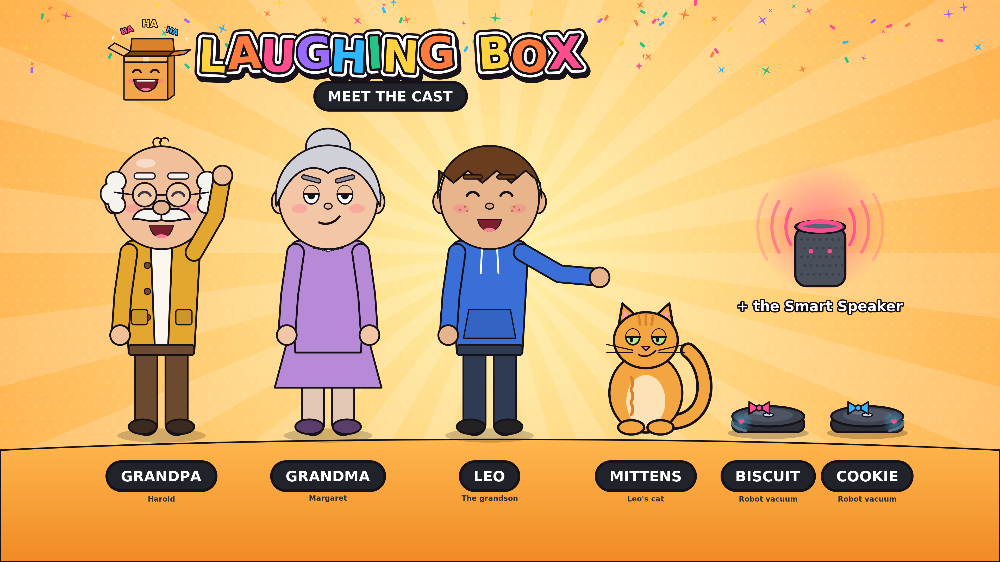

# Laughing Box characters

Every image is drawn by the same code the episodes use, so the characters are exactly on-model. Character PNGs have a **transparent background**, so you can drop them onto thumbnails, posts, banners or merch mockups.

## Cast poster



`cast-poster-3840x2160.png` (4K, 16:9): use it for a YouTube community post, Facebook post or channel trailer card.

## Characters (transparent PNG)

| Character | File | Who |
|---|---|---|
| Grandpa (Harold) | [`grandpa-harold.png`](grandpa-harold.png) | Proud, stubborn, never gives up |
| Grandma (Margaret) | [`grandma-margaret.png`](grandma-margaret.png) | Calm, smug, secretly a tech pro |
| Leo | [`leo.png`](leo.png) | The grandson, cheerful, facepalms a lot |
| Mittens | [`mittens.png`](mittens.png) | Leo's cat, sits on homework |
| Biscuit | [`biscuit.png`](biscuit.png) | Grandma's robot vacuum (pink bow) |
| Cookie | [`cookie.png`](cookie.png) | Biscuit's sibling (blue bow) |
| The Smart Speaker | [`smart-speaker.png`](smart-speaker.png) | Mishears everything |
| Teen staffer | [`teen-staffer.png`](teen-staffer.png) | Pickle Mart helper |
| Big shopper | [`big-shopper.png`](big-shopper.png) | Pickle Mart regular |
| Queue woman | [`queue-woman.png`](queue-woman.png) | Pickle Mart customer |
| Sleepy grandad | [`queue-grandad.png`](queue-grandad.png) | Pickle Mart customer |
| Balloon kid | [`queue-kid.png`](queue-kid.png) | Pickle Mart customer |
| Self-checkout | [`self-checkout.png`](self-checkout.png) | Grandpa's first enemy |

## Expression sheets

[`expressions-grandpa.png`](expressions-grandpa.png) · [`expressions-grandma.png`](expressions-grandma.png) · [`expressions-leo.png`](expressions-leo.png) · [`expressions-mittens.png`](expressions-mittens.png)

Use these as reference images in AI image/video tools (see the character-sheet prompts in [`../claude/project-knowledge/prompt-kit.md`](../claude/project-knowledge/prompt-kit.md)), so new art stays on-model.

## Rebuild

```bash
python make_characters.py .    # needs pycairo; uses the episode scripts
```

Add a new character by appending a row to `CAST` in `make_characters.py`.
